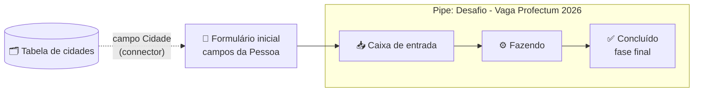
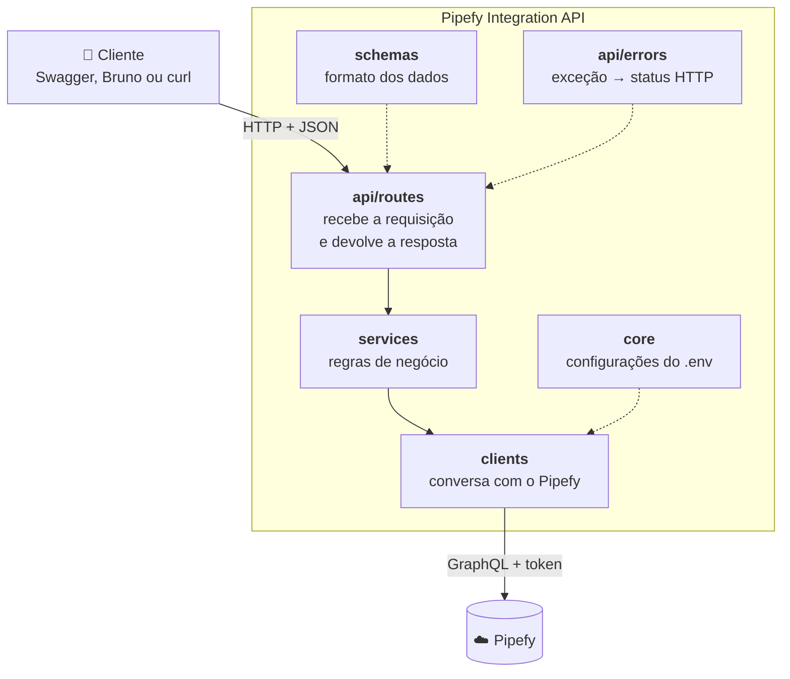
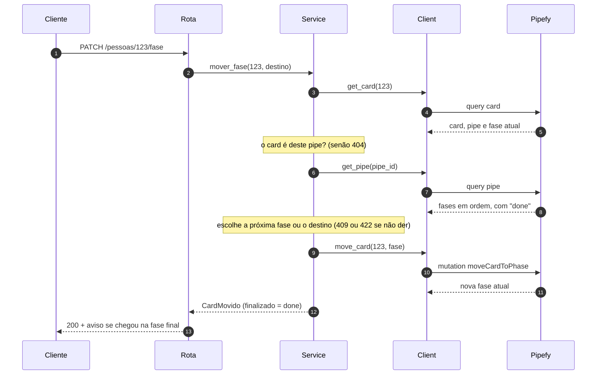
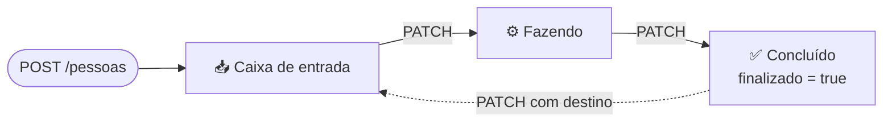
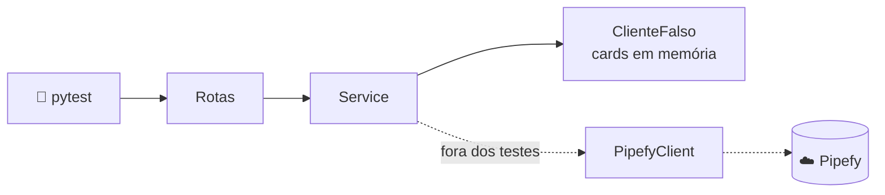

<div align="center">

# Pipefy Integration API

**API em Python que transforma um cadastro de Pessoas em cards do Pipefy:
cria, consulta, move entre fases e apaga, avisando quando o card chega ao fim do fluxo.**


[O desafio](#-o-desafio) •
[O Pipefy](#-entendendo-o-pipefy) •
[Arquitetura](#-arquitetura) •
[Endpoints](#-endpoints) •
[Demonstração](#-demonstração) •
[Qualidade](#-qualidade) •
[Como rodar](#-como-rodar)

</div>

---

## 📌 Em resumo

| | |
|---|---|
| **O que é** | uma API REST que integra um cadastro de Pessoas ao Pipefy pela API GraphQL |
| **Requisitos** | criar o card, apagar pelo ID e avançar ou mudar a fase, avisando na fase final |
| **Rotas** | cobre os 3 requisitos, mais consulta de cards, estrutura do pipe, cidades e health |
| **Testes** | 13, rodando em menos de 1 segundo, **sem token e sem internet** |
| **Para rodar** | Python 3.14 ou só o Docker (`docker compose up --build`) |

---

## 🎯 O desafio

Construir uma API em Python que se integre a um **pipe do Pipefy** usado para cadastrar
Pessoas, com três operações:

| # | Requisito | Rota | Resposta |
|:-:|---|---|:-:|
| 1 | Criar um card com os campos da Pessoa | `POST /pessoas` | `201` |
| 2 | Excluir um card pelo ID | `DELETE /pessoas/{id}` | `204` |
| 3 | Avançar ou mudar a fase do card e **avisar quando ele chega na fase final** | `PATCH /pessoas/{id}/fase` | `200` |

---

## 🧭 Entendendo o Pipefy

O Pipefy organiza processos em quadros, parecido com um kanban. Antes de escrever código,
explorei a API GraphQL para entender como o pipe do desafio é montado.

| Conceito | O que é | Neste projeto |
|---|---|---|
| **Pipe** | o quadro do processo | *Desafio - Vaga Profectum 2026* |
| **Fase** | uma coluna do quadro | Caixa de entrada → Fazendo → Concluído |
| **Card** | um item que anda pelas fases | uma Pessoa cadastrada |
| **Formulário inicial** | os campos preenchidos ao criar o card | nome, CPF, cidade, hobbies... |
| **Database (tabela)** | uma lista de registros reaproveitáveis | as cidades aceitas no cadastro |
| **Connector** | um campo que aponta para registros de uma tabela | o campo Cidade |



### Campos do formulário

| Campo | Tipo no Pipefy | Obrigatório | Como a API envia |
|---|---|:-:|---|
| Nome | texto curto | ✅ | texto; vira também o título do card |
| Cidade | connector | ✅ | lista com o **ID** do registro da tabela: `["850256930"]` |
| CPF | CPF | | `000.000.000-00` |
| Data de nascimento | data | | `AAAA-MM-DD` |
| Telefone | telefone | | texto |
| Sexo | opção única | | uma das opções do formulário |
| Hobbies | checklist | | lista de opções: `["Leitura", "Cinema"]` |
| Data de envio | data e hora | | preenchida automaticamente pela API |

## 🧱 Arquitetura

O código é dividido em camadas. Cada uma tem **uma responsabilidade** e só conversa
com a camada vizinha.



| Camada | Responsabilidade | Não sabe de... |
|---|---|---|
| **`api/routes`** | receber a requisição, validar pelo schema, definir o status de sucesso | Pipefy, GraphQL |
| **`schemas`** | o formato do que **entra** (com validações) e do que **sai** | de onde os dados vêm |
| **`services`** | regras: resolver a cidade, escolher a próxima fase, conferir se o card é do pipe | HTTP, GraphQL |
| **`clients`** | montar as queries GraphQL, enviar o token, tratar a resposta do Pipefy | regras de negócio |
| **`core`** | configurações lidas do `.env` (token, IDs, timeout) | todo o resto |
| **`api/errors`** | traduzir cada exceção no status HTTP certo, num lugar só | como o erro aconteceu |

### Estrutura de pastas

```
app/
├── main.py                 # cria o app e registra as rotas e o tratamento de erros
├── core/
│   └── config.py           # Settings: configurações lidas do .env
├── api/
│   ├── dependencies.py     # injeção de dependência: Settings → Client → Service
│   ├── errors.py           # exceções da aplicação → respostas HTTP
│   └── routes/
│       ├── pessoas.py      # POST, GET, PATCH e DELETE de /pessoas
│       └── pipe.py         # /pipe e /cidades
├── schemas/
│   ├── pessoa.py           # entrada do cadastro e validações (CPF, data, opções)
│   └── card.py             # formatos de resposta e o pedido de mudança de fase
├── services/
│   └── pessoas.py          # regras de negócio
└── clients/
    └── pipefy.py           # client da API GraphQL do Pipefy
tests/                      # testes com um Pipefy falso em memória
bruno/                      # coleção de requisições para a demonstração
```

### Uma requisição de ponta a ponta

O caminho de `PATCH /pessoas/{id}/fase`, o requisito mais completo:



### Onde mexer se...

| Se precisar... | Mexe em |
|---|---|
| adicionar um campo novo na Pessoa | `schemas/pessoa.py` (o campo) e `services/pessoas.py` (enviar ao Pipefy) |
| trocar o pipe ou o token | só no `.env` |
| o Pipefy mudar a API | só em `clients/pipefy.py` |
| criar uma regra nova (ex.: não aceitar CPF repetido) | `services/pessoas.py` |
| criar um erro novo com outro status | `services/` (a exceção) e `api/errors.py` (o status) |

---

## 🔌 Endpoints

Com a API rodando, a documentação interativa fica em **http://127.0.0.1:8000/docs** (Swagger).

### Pessoas

| Método | Rota | O que faz | Sucesso |
|---|---|---|:-:|
| `POST` | `/pessoas` | cadastra a Pessoa, criando o card na primeira fase | `201` |
| `GET` | `/pessoas` | lista os cards, do mais novo para o mais antigo (filtro opcional `?fase=`) | `200` |
| `GET` | `/pessoas/{id}` | detalha um card com todos os campos | `200` |
| `PATCH` | `/pessoas/{id}/fase` | avança o card ou move para a fase `destino` | `200` |
| `DELETE` | `/pessoas/{id}` | apaga o card | `204` |

### Apoio

| Método | Rota | O que faz |
|---|---|---|
| `GET` | `/pipe` | estrutura do pipe: fases e campos do formulário |
| `GET` | `/cidades` | cidades aceitas no campo Cidade |
| `GET` | `/health` | confirma que a API está no ar |

### Cadastro: campos aceitos (`POST /pessoas`)

| Campo | Tipo | Obrigatório | Regras |
|---|---|:-:|---|
| `nome` | texto | ✅ | 2 a 120 caracteres |
| `cidade` | texto | ✅ | precisa existir na tabela; aceita sem acento e em minúsculas |
| `cpf` | texto | | dígitos verificadores validados; com ou sem máscara |
| `data_de_nascimento` | data | | `AAAA-MM-DD`, não pode estar no futuro |
| `telefone` | texto | | 8 a 20 caracteres |
| `sexo` | opção | | `Masculino`, `Feminino` ou `Prefere não responder` |
| `hobbies` | lista | | `Teatro`, `Música`, `Cinema`, `Esportes`, `Leitura`, `Viagem`, `Artes` |

### Mudança de fase: o requisito 3



O `PATCH /pessoas/{id}/fase` funciona de dois jeitos:

- **sem corpo**: avança para a **próxima** fase;
- **com `{"destino": "..."}`**: vai direto para a fase indicada, pelo **nome**
  (sem diferenciar acento e maiúsculas, ex.: `"concluido"`) ou pelo **ID** da fase.

Ao chegar na fase final, a resposta avisa:

```json
{
  "id": "1474000000",
  "titulo": "Maria Silva",
  "fase_anterior": { "id": "323403003", "nome": "Fazendo" },
  "fase_atual": { "id": "323403004", "nome": "Concluído" },
  "finalizado": true,
  "mensagem": "O card chegou na fase final (Concluído)."
}
```

> [!NOTE]
> A fase final não está escrita no código: ela vem do próprio Pipefy (campo `done` da fase).
> Se o pipe ganhar uma fase nova ou mudar a ordem, a API continua funcionando.

---

## 🎬 Demonstração

A pasta [`bruno/`](bruno/) tem uma coleção do [Bruno](https://www.usebruno.com/) com o
fluxo completo, em ordem. Cada requisição confere sozinha o status esperado, e o ID do
card criado é guardado e reaproveitado nas seguintes.

| # | Requisição | Mostra | Status |
|:-:|---|---|:-:|
| 01 | Health | a API está no ar | `200` |
| 02 | Estrutura do pipe | fases e campos lidos do Pipefy | `200` |
| 03 | Cidades | as cidades aceitas | `200` |
| 04 | Cadastrar Pessoa | **requisito 1**: card criado (cidade em minúsculas, CPF sem máscara) | `201` |
| 05 | Listar Pessoas | o card novo aparece primeiro, sem dados pessoais | `200` |
| 06 | Detalhar Pessoa | os campos como ficaram no Pipefy (CPF formatado) | `200` |
| 07 | Avançar fase | **requisito 3**: Caixa de entrada → Fazendo | `200` |
| 08 | Avançar fase | Fazendo → Concluído, com **`finalizado: true`** | `200` |
| 09 | Avançar na fase final | não existe fase depois da final | `409` |
| 10 | Mover para fase específica | volta direto para a Caixa de entrada | `200` |
| 11 | Fase inexistente | o erro lista as fases válidas | `422` |
| 12 | Cidade inexistente | o erro lista as cidades válidas | `422` |
| 13 | CPF inválido | barrado antes de chegar ao Pipefy | `422` |
| 14 | Apagar Pessoa | **requisito 2**: card apagado | `204` |
| 15 | Card inexistente | o card apagado agora responde `404` | `404` |

**Para rodar:** no Bruno, **Open Collection** → pasta `bruno/` → com a API no ar, clique com
o botão direito na coleção → **Run**. O endereço `http://127.0.0.1:8000` já vem configurado.

---

## 🚨 Tratamento de erros

| Status | Quando | Exemplo de resposta |
|:-:|---|---|
| `422` | dados inválidos: CPF, data futura, opção inexistente, JSON mal formado | detalhe do campo com problema |
| `422` | cidade não cadastrada | `{"detail": "Cidade 'Recife' não encontrada.", "cidades_validas": [...]}` |
| `422` | fase de destino inexistente | `{"detail": "Fase 'xyz' não encontrada.", "fases_validas": [...]}` |
| `404` | card inexistente **ou de outro pipe** | `{"detail": "Card 123 não encontrado no pipe de Pessoas."}` |
| `409` | o card já está na fase final ou na fase de destino | `{"detail": "O card já está na fase final ('Concluído')."}` |
| `502` | o Pipefy recusou a operação ou respondeu com erro (ex.: token inválido) | `{"detail": "O Pipefy respondeu com erro HTTP 401."}` |
| `503` | o Pipefy não respondeu (fora do ar, sem internet ou timeout) | `{"detail": "Não foi possível se comunicar com o Pipefy."}` |

> [!TIP]
> A regra geral: **`4xx`** = o problema está no que foi enviado (dá para corrigir e tentar de novo);
> **`5xx`** = o problema está no Pipefy (não adianta mudar o pedido).

---

## ✅ Qualidade

### Testes automatizados

```bash
pytest -v
```

Os testes **não chamam o Pipefy e não precisam de token**. Pela injeção de dependência do
FastAPI, o client do Pipefy é trocado por um client falso que guarda os cards em memória
([`tests/conftest.py`](tests/conftest.py)). Rotas, validações, regras de negócio e tratamento
de erros rodam de verdade.



| Grupo | O que é testado |
|---|---|
| **Criar** (`POST`) | card na primeira fase, CPF formatado, cidade sem acento, cidade duplicada, cidade inexistente (`422`), CPF inválido sem chamar o Pipefy (`422`) |
| **Mover fase** (`PATCH`) | próxima fase, aviso de fase final, avançar na fase final (`409`), destino pelo nome, destino inexistente (`422`) |
| **Apagar** (`DELETE`) | exclusão (`204`), card inexistente (`404`), card de outro pipe **não** é apagado (`404`) |

### Padrão de código

```bash
ruff format .   # formatação
ruff check .    # lint: imports, variáveis não usadas, erros comuns
```

### Docker

A imagem usa Python 3.14 *slim*, roda com um usuário sem privilégios e **não inclui o `.env`**:
o token é lido só na hora de subir o contêiner.

---

## 🚀 Como rodar

### Opção 1: com Docker (só precisa do Docker)

```bash
git clone https://github.com/AlissonWork/pipefy-integration-api.git
cd pipefy-integration-api
cp .env.example .env        # depois, preencha o PIPEFY_TOKEN
docker compose up --build
```

### Opção 2: com Python 3.14

```bash
git clone https://github.com/AlissonWork/pipefy-integration-api.git
cd pipefy-integration-api

python -m venv .venv
source .venv/Scripts/activate   # Windows (Git Bash)
# source .venv/bin/activate     # Linux / macOS

pip install -r requirements-dev.txt
cp .env.example .env            # depois, preencha o PIPEFY_TOKEN

uvicorn app.main:app --reload
```

Nos dois casos, a API fica em:

| Endereço | O que é |
|---|---|
| http://127.0.0.1:8000/docs | documentação interativa (Swagger): dá para testar tudo por ali |
| http://127.0.0.1:8000/redoc | documentação em formato de leitura |
| http://127.0.0.1:8000/health | confirma que a API está no ar |

> [!IMPORTANT]
> O Docker e o `uvicorn` usam a mesma porta (8000): rode um de cada vez.

### Variáveis de ambiente (`.env`)

| Variável | Obrigatória | Descrição |
|---|:-:|---|
| `PIPEFY_TOKEN` | ✅ | token de acesso à API do Pipefy |
| `PIPEFY_PIPE_ID` | ✅ | ID do pipe de Pessoas (`303843596`) |
| `PIPEFY_CIDADE_TABLE_ID` | ✅ | ID da tabela de cidades (`yJ1z4HYx`) |
| `PIPEFY_API_URL` | | endereço da API GraphQL (padrão: `https://api.pipefy.com/graphql`) |
| `PIPEFY_TIMEOUT` | | segundos de espera pelo Pipefy (padrão: `10`) |

O `.env` está no `.gitignore`: o token nunca vai para o repositório.

<details>
<summary><b>📚 Exemplos com curl</b></summary>

<br>

**Cadastrar uma Pessoa**

```bash
curl -X POST http://127.0.0.1:8000/pessoas \
  -H "Content-Type: application/json" \
  -d '{
    "nome": "Maria Silva",
    "cidade": "Fortaleza",
    "cpf": "52998224725",
    "data_de_nascimento": "1995-08-20",
    "telefone": "85999999999",
    "sexo": "Feminino",
    "hobbies": ["Leitura", "Cinema"]
  }'
```

```json
{
  "id": "1474000000",
  "titulo": "Maria Silva",
  "url": "https://app.pipefy.com/pipes/303843596#cards/1474000000",
  "fase": { "id": "323403002", "nome": "Caixa de entrada" }
}
```

**Avançar a fase**

```bash
curl -X PATCH http://127.0.0.1:8000/pessoas/1474000000/fase
```

**Mover para uma fase específica**

```bash
curl -X PATCH http://127.0.0.1:8000/pessoas/1474000000/fase \
  -H "Content-Type: application/json" \
  -d '{"destino": "caixa de entrada"}'
```

**Listar (com filtro) e detalhar**

```bash
curl "http://127.0.0.1:8000/pessoas?fase=concluido"
curl http://127.0.0.1:8000/pessoas/1474000000
```

**Apagar**

```bash
curl -X DELETE http://127.0.0.1:8000/pessoas/1474000000
```

</details>

---

## 🧰 Tecnologias

| Ferramenta | Uso |
|---|---|
| **Python 3.14** | linguagem |
| **FastAPI** | framework web, validação e documentação automática |
| **Pydantic v2** e **pydantic-settings** | schemas, validações e configurações via `.env` |
| **httpx** | cliente HTTP assíncrono para a API GraphQL do Pipefy |
| **Uvicorn** | servidor ASGI |
| **pytest** | testes automatizados |
| **Ruff** | lint e formatação |
| **Docker** | execução em contêiner |
| **Bruno** | coleção de requisições para a demonstração |

---

## 🔭 Próximos passos

O que eu faria com mais tempo:

- **Testes do client do Pipefy** simulando o HTTP com `respx`: token no cabeçalho, erros do
  GraphQL, `401` e timeout.
- **CI no GitHub Actions** rodando Ruff e pytest a cada pull request.
- **Mapeamento de campos configurável**, para a API funcionar com outros pipes sem mudar o código.
- **Cache** das fases e das cidades, que mudam pouco, para reduzir chamadas ao Pipefy.
- **Logs estruturados** de cada operação, para auditoria.
